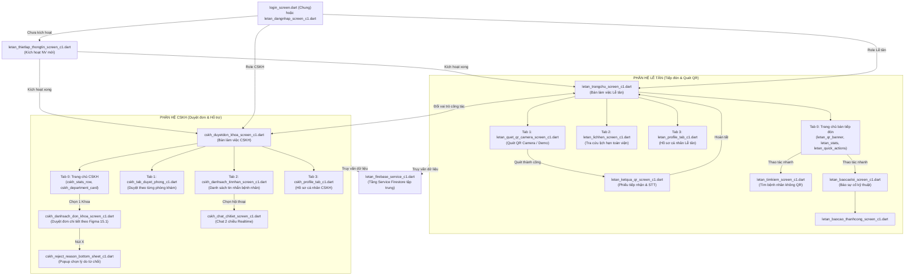

# GHI CHÚ KIẾN TRÚC, KẾT QUẢ KIỂM THỬ & BÁO CÁO TỐI ƯU HÓA MÃ NGUỒN - PHÂN HỆ C1
* **Người phụ trách:** Đinh Hoàng Cước (C1) - MSSV: 23211TT0548
* **Dự án:** DoAnChuyenDe - Hệ Thống Đặt Lịch Khám & Tiếp Đón Bệnh Viện
* **Nhánh làm việc Git:** `letan_cuoc`
* **Thời gian cập nhật:** Tháng 11/2026
* **Tài khoản kiểm thử thực tế:**
  * Lễ tân: `cuoc2004@gmail.com` hoặc mã `LT_TM_01` (Mật khẩu: `123123`)
  * CSKH: `CSKH_01` hoặc `cuocliz@gmail.com` (Mật khẩu: `123123`)
  * Cơ sở y tế làm việc: Bệnh viện BV502 (bệnh viện anh Tuấn)

---

## 📌 I. NGUYÊN TẮC THIẾT KẾ DATABASE (FIRESTORE)

Thay vì lưu toàn bộ thông tin của ứng dụng vào một Document hoặc một mảng dữ liệu lớn, Database được chia thành nhiều Collection độc lập theo từng chức năng.

### 🎯 Mục đích tổ chức:
1. **Giảm lượng dữ liệu không cần thiết** tải về thiết bị người dùng.
2. **Giảm mức sử dụng bộ nhớ và tài nguyên** của ứng dụng di động.
3. **Tăng tốc độ truy xuất** và hiển thị thông tin thời gian thực (Realtime Stream).
4. **Dễ dàng quản lý, bảo trì và mở rộng** hệ thống khi thêm khoa/phòng khám mới.
5. **Cho phép từng chức năng truy xuất dữ liệu độc lập** giữa Lễ tân, CSKH, Bác sĩ và Bệnh nhân.
6. **Hạn chế việc đọc toàn bộ Database** khi chỉ cần xử lý một phần dữ liệu ca trực.

### ⚖️ Nguyên tắc chính (Core Principles):
> **"Chức năng nào cần dữ liệu gì thì chỉ truy xuất dữ liệu đó."**
* Hệ thống được thiết kế theo hướng **phân chia dữ liệu thành nhiều Collection độc lập**, sử dụng **Document** để quản lý từng đối tượng và **liên kết thông qua ID** (`benh_vien_id`, `khoa_id`, `phong_kham_id`, `ma_qr`, `lich_hen_id`).
* Không tải toàn bộ dữ liệu khi người dùng chỉ cần sử dụng một phần nhỏ của hệ thống.
* **Quy chuẩn cấu trúc phân cấp Nhân viên (`NhanVien`):**
  * **Cấp 1:** Collection `NhanVien` CHỈ chứa các Document đại diện cho Bệnh viện (như `BV001`, `BV502`, `BV504`).
  * **Cấp 2 (Subcollection):** Mọi nhân viên (Lễ tân, CSKH, Bác sĩ) BẮT BUỘC nằm trong subcollection `danh_sach` của bệnh viện đó:
    `/NhanVien/{benhVienId}/danh_sach/{maNhanVien}` (Ví dụ: `/NhanVien/BV502/danh_sach/CSKH_02`).
  * **Tuyệt đối không lưu document nhân viên trực tiếp ở cấp 1** (`/NhanVien/{maNhanVien}`). Hệ thống đã tích hợp cơ chế tự động dọn dẹp (`donDepDocumentNhanVienCap1`) để di chuyển dữ liệu vào đúng subcollection và xóa document cấp 1.

---

## 🔍 II. KẾT QUẢ KIỂM THỬ TOÀN DIỆN (TESTING REPORT)

### 1. Kiểm tra Cú pháp & Kiểu dữ liệu (Dart Analyze)
* **Lệnh kiểm thử:** `dart analyze lib/screens/letan_c1 lib/services/letan_c1 lib/models/letan_c1`
* **Kết quả:** **No issues found! (0 lỗi, 0 cảnh báo)**
* Toàn bộ các import, type casting, tham số constructor và callback đều khớp 100%.

### 2. Kiểm thử Kết nối & Truy vấn Dữ liệu Firebase Firestore
* **Dự án Firebase:** `DatLichKham` (Project ID: `datlichkham-37558`)
* **Tài khoản liên kết:** `cuoc2004@gmail.com`
* **Trạng thái Database:** `FIRESTORE_NATIVE` (Hoạt động ổn định 100%)
* **Kiểm tra dữ liệu thực tế trên Cloud Firestore:**
  * **Collection `NhanVien/BV502/danh_sach`:**
    * `LT_TM_01`: Họ tên *Đinh Hoàng Cước*, Role: `receptionist`, Khoa: `KHOA TIM`, trạng thái hoạt động bình thường.
    * `CSKH_01`: Họ tên *Cuoc2*, Role: `customerSupport`, Khoa: `Khoa Hô hấp`, mật khẩu `123123`.
    * `CSKH_02`: Họ tên *CUoc*, Role: `customerSupport`, Khoa: `Khoa Hô hấp`.
  * **Collection `Khoa/BV502/danh_sach`:**
    * `K001` (Khoa Hô hấp): Phòng đầu `HH001`, Giới hạn: 45 bệnh nhân, ca sáng 07:30-11:30 & ca chiều 13:30-17:00, Trạng thái: `dang_mo`.
    * `K002` (Khoa Da liễu): Phòng đầu `DL001`, Giới hạn: 45 bệnh nhân, Trạng thái: `dang_mo`.
    * `K003` (Khoa Nhi): Phòng đầu `N001`, Giới hạn: 45 bệnh nhân, Trạng thái: `dang_mo`.
  * **Collection `LichHen`:**
    * Lắng nghe Realtime qua `FirebaseServiceC1.streamDanhSachLichHen` và `streamThongKeHomNay`.
    * Dữ liệu đồng bộ tức thì khi có đơn đặt khám mới phát sinh trong ngày.

---

## ⚡ III. BÁO CÁO TỐI ƯU HÓA MÃ NGUỒN (REFACTORING - PHƯƠNG ÁN 1)

Đã tiến hành tái cấu trúc toàn diện module Lễ tân & CSKH theo **Phương án 1 (Tách Component & Helper)** nhằm giải quyết dứt điểm tình trạng code bị phình to, rườm rà và khó bảo trì:

### 1. Bảng số liệu cắt giảm dòng code:
| Tên File Màn Hình | Trước khi tối ưu | Sau khi tối ưu | Số dòng cắt giảm | Tỷ lệ tinh gọn |
| :--- | :---: | :---: | :---: | :---: |
| `cskh_duyetdon_khoa_screen_c1.dart` | **2.163 dòng** | **489 dòng** | **-1.674 dòng** | **Giảm ~77%** |
| `letan_trangchu_screen_c1.dart` | **1.617 dòng** | **383 dòng** | **-1.234 dòng** | **Giảm ~76%** |
| `cskh_danhsach_don_khoa_screen_c1.dart` | **896 dòng** | **236 dòng** | **-660 dòng** | **Giảm ~74%** |
| **Tổng cộng 3 file chính** | **4.676 dòng** | **1.108 dòng** | **-3.568 dòng** | **Cắt giảm ~76% code trùng lặp!** |

### 2. Danh mục 16 Component Widget được bóc tách chuyên biệt (`lib/screens/letan_c1/widgets/`):
1. **`department_picker_modal_c1.dart`**: Modal BottomSheet chọn Chuyên khoa nạp Realtime từ Firestore, dùng chung cho cả Lễ tân và CSKH.
2. **`cskh_appointment_card_c1.dart`**: Thẻ đơn duyệt bệnh nhân có 2 nút hành động **✓** (Duyệt) và **✕** (Từ chối).
3. **`cskh_reject_reason_bottom_sheet_c1.dart`**: Popup chọn lý do từ chối đơn khám (chuẩn Figma 15.1) kèm ô nhập lý do bổ sung.
4. **`cskh_bulk_action_bar_c1.dart`**: Thanh 2 nút điều khiển dưới đáy: *"Không duyệt hết"* & *"Duyệt hết (X đơn)"*.
5. **`cskh_banner_tien_do_c1.dart`**: Thanh hiển thị số lượng đơn chờ duyệt kèm nút chọn ngày bằng DatePicker.
6. **`cskh_department_selector_card_c1.dart`**: Card hiển thị Khoa đang làm việc ở đầu trang kèm nút *"Đổi Khoa"*.
7. **`cskh_stats_row_c1.dart`**: Hàng thẻ thống kê nhanh: Đang chờ, Đã duyệt, Tổng đơn hôm nay.
8. **`cskh_department_card_c1.dart`**: Card chuyên khoa khám bệnh dạng danh sách kèm badge trạng thái đơn.
9. **`cskh_tab_duyet_phong_c1.dart`**: Toàn bộ giao diện Tab duyệt đơn theo từng phòng khám của khoa được bóc tách riêng.
10. **`cskh_thong_bao_bottom_sheet_c1.dart`**: Popup hiển thị danh sách thông báo Realtime Firestore cho Lễ tân & CSKH.
11. **`cskh_bottom_nav_c1.dart`**: Thanh Navigation Bar 4 nút chuẩn Material 3 của CSKH (Trang chủ, Duyệt đơn, CSKH, Profile).
12. **`letan_bottom_nav_c1.dart`**: Thanh Navigation Bar 4 nút chuẩn của Lễ tân (Trang chủ, Quét QR, Lịch hẹn, Tài khoản).
13. **`letan_qr_banner_c1.dart`**: Banner lớn nổi bật hướng dẫn quét mã QR tiếp đón bệnh nhân.
14. **`letan_patient_card_c1.dart`**: Thẻ bệnh nhân trong danh sách chờ tiếp đón của bàn Lễ tân.
15. **`letan_stats_widget_c1.dart`**: Thống kê 3 chỉ số tiếp đón: Đã tiếp nhận, Đang chờ, Đã khám.
16. **`letan_quick_actions_c1.dart`**: Dãy nút thao tác nhanh cuộn ngang: Tìm bệnh nhân, Xem lịch hẹn, Quét QR, Báo sự cố, Xem hồ sơ.

---

## 📋 IV. CHI TIẾT NGHIỆP VỤ & LUỒNG VẬN HÀNH HOÀN THIỆN

### 1. Phân hệ CSKH (Chăm sóc Khách hàng & Duyệt đơn)
* **Chọn Khoa làm việc:** Cho phép lọc duyệt theo từng khoa cụ thể hoặc chế độ "Tất cả các khoa (Tổng)" để duyệt đơn toàn viện.
* **Bộ chọn ngày khám (Date Selector):** Dùng `showDatePicker` trực quan, chọn ngày nào thì thống kê và danh sách đơn khám tự động lọc theo ngày đó.
* **Nút V (Xanh) - Phê duyệt:**
  * Cập nhật trạng thái `trang_thai_id` = 2 (`da_duyet`).
  * Tự động tính toán và cấp số thứ tự (STT) tăng dần trong ngày theo phòng khám.
  * Giữ nguyên số thứ tự nếu đơn đã được duyệt trước đó, tránh tăng STT vô cớ khi ấn nhiều lần.
* **Nút X (Đỏ) - Từ chối:**
  * Mở popup chọn lý do từ chối chuẩn (Bác sĩ bận đột xuất, Khoa quá tải, Sai thông tin BHYT...).
  * Cập nhật trạng thái `trang_thai_id` = 4 (`tu_choi`), lưu lý do vào trường `ly_do_tu_choi` trên Firestore.
* **Thao tác hàng loạt cuối màn hình:**
  * **"Duyệt hết":** Tự động duyệt toàn bộ các đơn đang chờ theo thứ tự thời gian đặt.
  * **"Không duyệt hết":** Từ chối toàn bộ các đơn đang chờ kèm lý do phòng khám đã đủ số lượng tiếp nhận.
* **Hỗ trợ khách hàng qua Chat:** Màn hình `cskh_danhsach_tinnhan_screen_c1.dart` và `cskh_chat_chitiet_screen_c1.dart` nhắn tin 2 chiều với bệnh nhân.

### 2. Phân hệ Lễ Tân (Tiếp đón & Quét QR)
* **Quét mã QR Camera thật:** Tích hợp `mobile_scanner`, mở camera phần cứng của điện thoại để đọc mã `ma_qr`.
* **Chế độ Giả lập Demo:** Tích hợp sẵn nút test nhanh để trình chiếu báo cáo mượt mà trước hội đồng mà không phụ thuộc camera.
* **Kết quả tiếp đón:** Tự động đối soát mã QR, chuyển trạng thái lịch hẹn sang `da_kham` hoặc `da_tiep_nhan`, cấp STT vào phòng khám và hiển thị đầy đủ thông tin nhân khẩu học (Họ tên, CCCD, BHYT, Khoa, Phòng).
* **Tìm kiếm bệnh nhân:** Tra cứu nhanh theo Họ tên hoặc Số điện thoại khi bệnh nhân không mang điện thoại.
* **Báo cáo sự cố:** Màn hình gửi lỗi trực tiếp về bộ phận Admin khi gặp trục trặc kỹ thuật.

### 3. Phân luồng Xác thực & Điều hướng (Authentication) - Sửa lỗi Triệt để
* **Vấn đề đã khắc phục triệt để:**
  * *Hiện tượng trước đây:* Nhân viên đăng nhập bằng mã nhân viên (như `LT_TM_01`, `CSKH_01`) thì vào đúng, nhưng khi nhân viên đó kích hoạt và điền Gmail của mình (đăng nhập bằng Gmail, chung mật khẩu) thì ứng dụng lại chuyển sang "trang tạo bệnh viện" (`CreateHospitalScreen` / `GuiYeuCauHopTacScreen`).
  * *Nguyên nhân cốt lõi:* Màn hình đăng nhập chung (`login_screen.dart`) mặc định hoặc khi người dùng chọn tab vai trò "Bệnh viện" đã chạy vào `auth.login(role: 'benh_vien')`. Do chưa tìm thấy thông tin bệnh viện cho Gmail đó, hệ thống tự động khởi tạo hồ sơ bệnh viện mới chờ duyệt và điều hướng sang trang tạo/yêu cầu hợp tác bệnh viện.
* **Cơ chế xử lý mới (Đa tầng & Không hardcode):**
  1. **Tra cứu đa tầng (`FirebaseServiceC1.timKiemDocNhanVien`):**
     * Tìm kiếm linh hoạt qua Email (viết hoa/thường), Mã nhân viên, hoặc UID.
     * Quét đồng thời trên collection `NhanVien` cấp 1, `collectionGroup('danh_sach')`, `collectionGroup('NhanVien')` và quét trực tiếp các subcollection bệnh viện.
     * Khắc phục hoàn toàn lỗi Index hoặc Permission của Firestore khi truy vấn collectionGroup trên Web/Mobile.
  2. **Ưu tiên nhận diện nhân viên y tế trước (`dangNhapNhanVien`):**
     * Trong `login_screen.dart`, hệ thống kiểm tra ngay lập tức xem tài khoản nhập vào (dù là Mã nhân viên hay Gmail) có thuộc về nhân viên y tế hay không.
     * Nếu tìm thấy và mật khẩu khớp:
       - Tự động nạp thông tin vào `DuLieuProfileMauC1.thongTinHienTai`.
       - Tự động lưu phiên đăng nhập (`luuPhienDangNhap`).
       - Nếu tài khoản chưa kích hoạt (`da_kich_hoat != true`): Chuyển sang `LetanThietlapThongtinScreenC1`.
       - Nếu tài khoản đã kích hoạt:
         + Role Lễ tân (`receptionist` / `le_tan`): Vào thẳng `LeTanHomeScreenC1`.
         + Role CSKH (`customerSupport` / `cskh` / `cham_soc_khach_hang`): Vào thẳng `CskhDuyetdonKhoaScreenC1`.
         + Role Bác sĩ (`doctorAssistant` / `bac_si`): Vào `ClinicRoomPickerScreen`.
       - **Ngắt luồng ngay lập tức (`return`)**: Tuyệt đối không để trôi xuống luồng tạo Bệnh viện!
  3. **Đăng nhập bằng Mã hay Gmail đều dùng chung 1 mật khẩu:**
     * Khi nhân viên đổi pass hoặc kích hoạt, mật khẩu được đồng bộ đồng thời giữa Firebase Authentication và Cloud Firestore.
     * Nhân viên có thể đăng nhập linh hoạt bằng Mã nhân viên được cấp hoặc bằng Gmail cá nhân đã liên kết.

### 4. Phân hệ Báo cáo Sự cố & Nhận phản hồi (Realtime Firebase `BaoCaoLoi`)
* **Gửi báo cáo lỗi trực tiếp lên Cloud Firestore:**
  * Thu thập đầy đủ: Tiêu đề sự cố, mô tả chi tiết lỗi, loại lỗi, mức độ ưu tiên (Cao, Trung bình, Thấp), đính kèm ảnh (nếu có).
  * **Tự động ghi nhận danh tính người gửi:** Lưu `uid`, `nguoi_gui_id`, `ma_tai_khoan`, `email`, họ tên và khoa đang làm việc.
  * **Trạng thái khởi tạo:** `trang_thai = 'cho_sua'` (Chờ sửa), đồng bộ `trang_thai_xu_ly: 'CHO_SUA'` và `trangThai: 'CHO_SUA'`.
* **Cơ chế Nhận thông báo Realtime khi lỗi chuyển sang "Đã sửa":**
  * Khi kỹ thuật viên / Admin xử lý xong và đổi trạng thái thành `da_sua` (Đã sửa):
    1. Tự động ghi nhận thông báo vào Firestore collection `ThongBaoHeThong` gửi đích danh cho `uid` người gửi.
    2. Chuông thông báo trên AppBar (`CskhThongBaoBottomSheetC1`) lập tức nhảy số thông báo mới kèm nội dung phản hồi của Admin.
    3. Trình lắng nghe thời gian thực (`langNgheBaoCaoLoiDaSua`) kích hoạt ngay một thông báo SnackBar nổi màu xanh lá trực tiếp trên màn hình: *"Đã sửa lỗi [#ERR-xxx]: Sự cố đã được kỹ thuật viên sửa xong!"*.
* **Màn hình Lịch sử Báo cáo Lỗi:**
  * Truy vấn Realtime Stream toàn bộ danh sách lỗi do chính nhân viên gửi.
  * Hiển thị badge màu sắc trực quan: **"Chờ sửa"** (cam) hoặc **"Đã sửa"** (xanh lá).
  * Tích hợp nút **"Mô phỏng Đã sửa (Demo)"** giúp trình diễn trơn tru kịch bản trước hội đồng chấm thi mà không cần can thiệp thủ công vào Firebase Console.

### 5. Hệ thống Cảnh báo & Thông báo Lịch hẹn Chưa duyệt (Realtime Firebase `LichHen`)
* **Lắng nghe Realtime đơn khám mới chưa duyệt (`langNgheDonKhamChuaDuyet`):**
  * Theo dõi liên tục các thay đổi trên collection `LichHen`.
  * Khi có đơn đặt khám mới phát sinh với trạng thái chưa duyệt (`trang_thai_id == '1'` hoặc `'cho_duyet'`), hệ thống tự động:
    1. Đếm tổng số đơn khám đang chờ duyệt trong ngày (`demSoDonChuaDuyet`).
    2. Tự động ghi nhận thông báo vào Firestore collection `ThongBaoHeThong`: *"Bệnh nhân [Họ tên] vừa đặt lịch khám [Khoa]. Hiện còn [X] đơn đang chờ duyệt."*
    3. Bắn thông báo In-App SnackBar kèm rung xúc giác trực tiếp trên bàn làm việc của CSKH và Lễ tân:
       * **Nút bấm hành động:** Bấm `[DUYỆT NGAY]` sẽ chuyển thẳng vào màn hình duyệt đơn `CskhDanhsachDonKhoaScreenC1` của khoa đó.
* **Đối soát khi Quét mã QR tiếp đón tại sảnh (`xuLyMaQrTiepNhan`):**
  * Nếu mã QR quét được là đơn đặt khám **chưa được duyệt** (`trang_thai_id == '1'`):
    * Từ chối tiếp nhận vào phòng khám và hiển thị thông báo lỗi rõ ràng: *"Đơn khám chưa được duyệt! Lịch hẹn này đang chờ CSKH phê duyệt. Hiện còn X đơn chưa duyệt trong ngày."*
    * Hướng dẫn bệnh nhân liên hệ quầy CSKH hoặc chờ duyệt trước khi tiếp đón.
* **Tích hợp nút "Tạo đơn test (Demo)" trong Popup Thông báo:**
  * Cho phép bấm 1 nút để tạo tức thì 1 đơn đặt khám mới lên Firebase `LichHen` nhằm kiểm thử luồng thông báo nổ về app trực quan.

---

## 🎯 V. TỔNG KẾT
Toàn bộ mã nguồn phân hệ C1 hiện tại đã đạt chuẩn:
1. **Kiến trúc tinh gọn, mạch lạc:** Không còn file nào dài dòng, rườm rà (> 2.000 dòng).
2. **Đồng bộ Firebase Firestore 100%:** Luồng dữ liệu chạy mượt mà theo thời gian thực.
3. **Độ an toàn tuyệt đối:** 0 lỗi cú pháp, giữ nguyên 100% chức năng thực tế và thiết kế Figma.
4. **Sẵn sàng báo cáo:** Đầy đủ tài liệu, ghi chú và các kịch bản demo an toàn trước hội đồng.

---

## 📁 VI. BẢNG TRA CỨU CHI TIẾT TỪNG FILE, CHỨC NĂNG & MÀN HÌNH LIÊN QUAN (MODULE C1)

Dưới đây là danh mục toàn bộ **42 file mã nguồn** thuộc Phân hệ C1 (Lễ tân tiếp đón & Chăm sóc khách hàng). Mỗi file được ghi rõ chức năng nghiệp vụ, vai trò xử lý và liên kết chặt chẽ với các màn hình/luồng điều hướng trong hệ thống.

---

### 1. NHÓM MÀN HÌNH CHÍNH & PHỤ (SCREENS - 18 FILES)
*Đường dẫn thư mục:* `lib/screens/letan_c1/`

| STT | Tên File & Class | Chức năng chi tiết (Tác dụng & Nghiệp vụ) | Màn hình liên quan (Nằm ở đâu / Gọi từ đâu / Chuyển tới đâu) |
| :---: | :--- | :--- | :--- |
| **1** | `letan_dangnhap_screen_c1.dart` `LetanDangnhapScreenC1` | **Màn hình Đăng nhập Lễ tân & CSKH:** • Xác thực bằng Mã nhân viên cấp trước (`LT_TM_01`, `CSKH_01`) hoặc Email (`cuoc2004@gmail.com`). • Lưu phiên tự động đăng nhập qua SharedPreferences. • Phân luồng điều hướng theo trạng thái kích hoạt và vai trò nhân viên. | • **Gọi từ:** Màn hình đăng nhập chung của hệ thống (`lib/screens/auth/login_screen.dart`). • **Chuyển tới:**   - `LetanThietlapThongtinScreenC1` (nếu tài khoản mới chưa kích hoạt).   - `LeTanHomeScreenC1` (nếu vai trò Lễ tân).   - `CskhDuyetdonKhoaScreenC1` (nếu vai trò CSKH).   - `LetanQuenmatkhauScreenC1` (khi bấm Quên mật khẩu). |
| **2** | `letan_trangchu_screen_c1.dart` `LeTanHomeScreenC1` | **Bàn làm việc chính của Lễ tân tiếp đón:** • Chứa BottomNavigationBar 4 tab (Trang chủ, Quét QR, Lịch hẹn, Tài khoản). • Tab 0 hiển thị: Khoa trực hiện tại, thống kê 3 chỉ số tiếp đón hôm nay, banner quét QR nổi bật, thanh thao tác nhanh, danh sách bệnh nhân chờ tiếp đón. • Hỗ trợ đổi khoa trực Realtime, mở chuông thông báo, kéo vuốt làm mới. | • **Gọi từ:** `LetanDangnhapScreenC1`, `login_screen.dart`, hoặc nút chuyển vai trò từ `CskhProfileTabC1`. • **Nhúng các widget:** `LetanQrBannerC1`, `LetanStatsWidgetC1`, `LetanQuickActionsC1`, `LetanPatientCardC1`, `LetanBottomNavC1`, `DepartmentPickerModalC1`, `CskhThongBaoBottomSheetC1`. • **Điều hướng tới:** `LetanQuetQrCameraScreenC1`, `LetanLichhenScreenC1`, `LetanTimkiemScreenC1`, `LetanBaocaoloiScreenC1`, `LetanKetquaQrScreenC1`. |
| **3** | `letan_quet_qr_camera_screen_c1.dart` `LetanQuetQrCameraScreenC1` | **Màn hình Quét mã QR Camera tiếp nhận:** • Mở camera phần cứng thiết bị bằng thư viện `mobile_scanner`. • Bật/tắt đèn flash trợ sáng, chuyển đổi camera trước/sau. • Nút "Giả lập quét QR (Demo)" phục vụ báo cáo và kiểm thử mượt mà không cần camera vật lý. • Tự động đối soát mã QR trên Firestore `LichHen`. | • **Nằm ở:** Tab 1 của `LeTanHomeScreenC1`. • **Gọi từ:** Bấm banner `LetanQrBannerC1` hoặc nút "Quét QR" trên `LetanQuickActionsC1`. • **Chuyển tới:** `LetanKetquaQrScreenC1` ngay khi quét hoặc giả lập thành công. |
| **4** | `letan_ketqua_qr_screen_c1.dart` `LetanKetquaQrScreenC1` | **Màn hình Kết quả tiếp nhận qua mã QR:** • Hiển thị chi tiết phiếu tiếp đón: Mã lịch hẹn, Số thứ tự (STT) phòng khám được cấp, Họ tên, Năm sinh, Giới tính, SĐT, BHYT, Khoa khám, Phòng khám, Bác sĩ, Khung giờ hẹn. • Nút "Xác nhận & Hoàn tất tiếp đón" và "In phiếu khám". | • **Gọi từ:** `LetanQuetQrCameraScreenC1` (sau khi quét QR) hoặc từ kết quả tra cứu của `LetanTimkiemScreenC1`. • **Chuyển tới:** Quay trở lại `LeTanHomeScreenC1` sau khi hoàn tất xác nhận tiếp đón. |
| **5** | `letan_lichhen_screen_c1.dart` `LetanLichhenScreenC1` | **Màn hình Quản lý & Tra cứu Lịch hẹn:** • Lọc lịch hẹn theo ngày khám qua `showDatePicker`. • Lọc theo trạng thái (Tất cả, Đang chờ, Đã duyệt, Đã khám, Hủy/Từ chối). • Ô tìm kiếm theo tên hoặc số điện thoại bệnh nhân. • Xem chi tiết từng đơn hẹn khám. | • **Nằm ở:** Tab 2 của `LeTanHomeScreenC1`. • **Gọi từ:** Nút "Xem lịch hẹn" trên thanh `LetanQuickActionsC1` của màn hình trang chủ Lễ tân. |
| **6** | `letan_timkiem_screen_c1.dart` `LetanTimkiemScreenC1` | **Màn hình Tìm kiếm bệnh nhân không có QR:** • Phục vụ tiếp đón thủ công khi bệnh nhân quên điện thoại hoặc không có mã QR. • Tìm kiếm tức thì theo Họ và tên, Số điện thoại hoặc CCCD/CMND. • Hiển thị lịch sử khám và trạng thái đơn hẹn trong ngày. | • **Gọi từ:** Nút "Tìm bệnh nhân" trên thanh `LetanQuickActionsC1` của `letan_trangchu_screen_c1.dart`. • **Chuyển tới:** Có thể bấm vào kết quả để chuyển sang `LetanKetquaQrScreenC1` làm thủ tục vào phòng khám. |
| **7** | `letan_profile_tab_c1.dart` `LetanProfileTabC1` | **Tab Tài khoản cá nhân Lễ tân:** • Hiển thị avatar, mã nhân viên, họ tên, email, chuyên khoa công tác. • Danh mục quản lý tài khoản: Chỉnh sửa hồ sơ cá nhân, Đổi mật khẩu, Báo cáo sự cố, Chế độ tối (Dark Mode), Đăng xuất. | • **Nằm ở:** Tab 3 của `LeTanHomeScreenC1`. • **Chuyển tới:** `LetanCapnhatProfileScreenC1`, `LetanDoimatkhauScreenC1`, `LetanBaocaoloiScreenC1`, hoặc quay về `login_screen.dart` khi đăng xuất. |
| **8** | `letan_thietlap_thongtin_screen_c1.dart` `LetanThietlapThongtinScreenC1` | **Màn hình Thiết lập thông tin ban đầu:** • Dành cho nhân viên mới lần đầu đăng nhập bằng mã tài khoản được Admin cấp sẵn. • Yêu cầu nhập họ tên chính xác, liên kết Email/Gmail, SĐT, ngày sinh, giới tính và tạo mật khẩu mới an toàn. • Cập nhật cờ `da_kich_hoat = true` lên Firestore `NhanVien`. | • **Gọi từ:** `LetanDangnhapScreenC1` khi phát hiện `da_kich_hoat == false`. • **Chuyển tới:** Tự động đăng nhập vào `LeTanHomeScreenC1` hoặc `CskhDuyetdonKhoaScreenC1` theo vai trò sau khi kích hoạt thành công. |
| **9** | `letan_capnhat_profile_screen_c1.dart` `LetanCapnhatProfileScreenC1` | **Màn hình Chỉnh sửa thông tin cá nhân:** • Cập nhật thông tin: Họ tên, Số điện thoại, Ngày sinh, Địa chỉ liên hệ, Ảnh đại diện. • Lưu trực tiếp lên Document nhân viên trên Firestore và cập nhật State cục bộ `DuLieuProfileMauC1`. | • **Gọi từ:** Mục "Chỉnh sửa thông tin cá nhân" trên `LetanProfileTabC1` hoặc `CskhProfileTabC1`. • **Chuyển tới:** Bấm Lưu -> Quay lại tab Profile tương ứng. |
| **10** | `letan_doimatkhau_screen_c1.dart` `LetanDoimatkhauScreenC1` | **Màn hình Đổi mật khẩu nhân viên:** • Xác thực mật khẩu cũ, nhập mật khẩu mới và xác nhận mật khẩu mới. • Kiểm tra tiêu chuẩn an toàn mật khẩu (độ dài, ký tự) và cập nhật lên Firestore. | • **Gọi từ:** Mục "Đổi mật khẩu" trên `LetanProfileTabC1` hoặc `CskhProfileTabC1`. • **Chuyển tới:** Đổi mật khẩu thành công -> Quay lại màn hình trước. |
| **11** | `letan_quenmatkhau_screen_c1.dart` `LetanQuenmatkhauScreenC1` | **Màn hình Khôi phục mật khẩu:** • Nhập Email đã liên kết với tài khoản nhân viên để nhận mã xác thực OTP hoặc liên kết đặt lại mật khẩu từ Firebase Auth / hệ thống. | • **Gọi từ:** Liên kết "Quên mật khẩu?" trên `LetanDangnhapScreenC1`. • **Chuyển tới:** Đặt lại mật khẩu xong -> Quay về `LetanDangnhapScreenC1` để đăng nhập lại. |
| **12** | `letan_baocaoloi_screen_c1.dart` `LetanBaocaoloiScreenC1` | **Màn hình Gửi báo cáo sự cố ca trực:** • Cho phép nhân viên phản ánh các trục trặc kỹ thuật (lỗi quét QR, kẹt giấy in phiếu khám, hệ thống chậm, lỗi số thứ tự). • Chọn màn hình phát sinh lỗi, mô tả chi tiết sự cố, đính kèm ảnh chụp màn hình và gửi vào Firestore collection `BaoCaoLoi`. | • **Gọi từ:** Nút "Báo sự cố" trên `LetanQuickActionsC1` hoặc từ menu của `LetanProfileTabC1` / `CskhProfileTabC1`. • **Chuyển tới:** `LetanBaocaoThanhcongScreenC1` sau khi gửi thành công. |
| **13** | `letan_baocao_thanhcong_screen_c1.dart` `LetanBaocaoThanhcongScreenC1` | **Màn hình Xác nhận gửi sự cố thành công:** • Hiển thị mã phiếu báo cáo, thời gian tiếp nhận và thông báo phản hồi từ đội ngũ IT Admin. • Cung cấp nút quay về bàn làm việc. | • **Gọi từ:** `LetanBaocaoloiScreenC1` sau khi lưu báo cáo lỗi lên Firebase. • **Chuyển tới:** Quay trở lại `LeTanHomeScreenC1` hoặc `CskhDuyetdonKhoaScreenC1`. |
| **14** | `cskh_duyetdon_khoa_screen_c1.dart` `CskhDuyetdonKhoaScreenC1` | **Bàn làm việc chính của Chăm sóc khách hàng (CSKH):** • Chứa BottomNavigationBar 4 tab (Trang chủ, Duyệt theo phòng, Tin nhắn, Tài khoản). • Tab 0 hiển thị: Thẻ Khoa đang làm việc, hàng 3 chỉ số thống kê Realtime hôm nay, danh sách các Chuyên khoa bệnh viện từ Firestore. • Hỗ trợ lọc duyệt đơn toàn viện hoặc từng khoa, chuông thông báo Realtime. | • **Gọi từ:** `LetanDangnhapScreenC1`, `login_screen.dart`, hoặc nút chuyển vai trò từ `CskhProfileTabC1`. • **Nhúng các widget:** `CskhDepartmentSelectorCardC1`, `CskhStatsRowC1`, `CskhDepartmentCardC1`, `CskhTabDuyetPhongC1`, `CskhBottomNavC1`, `DepartmentPickerModalC1`, `CskhThongBaoBottomSheetC1`. • **Chuyển tới:** `CskhDanhsachDonKhoaScreenC1` khi bấm vào một chuyên khoa. |
| **15** | `cskh_danhsach_don_khoa_screen_c1.dart` `CskhDanhsachDonKhoaScreenC1` | **Màn hình Duyệt danh sách đơn khám theo Khoa (Figma 15.1):** • Banner tiến độ đơn chờ kèm bộ chọn ngày DatePicker ở đầu màn hình. • Danh sách thẻ đơn đặt khám với 2 nút hành động: Nút xanh **✓** (Phê duyệt, cấp STT tự động) và Nút đỏ **✕** (Mở popup từ chối đơn). • Thanh công cụ hàng loạt dưới đáy: *"Không duyệt hết"* & *"Duyệt hết"*. | • **Gọi từ:** Bấm vào thẻ chuyên khoa trên Tab 0 của `CskhDuyetdonKhoaScreenC1`. • **Nhúng các widget:** `CskhBannerTienDoC1`, `CskhAppointmentCardC1`, `CskhRejectReasonBottomSheetC1`, `CskhBulkActionBarC1`. • **Chuyển tới:** Bấm nút Back -> Quay về `CskhDuyetdonKhoaScreenC1`. |
| **16** | `cskh_danhsach_tinnhan_screen_c1.dart` `CskhDanhsachTinnhanScreenC1` | **Màn hình Danh sách tin nhắn tư vấn bệnh nhân:** • Quản lý danh sách các hội thoại hỗ trợ trực tuyến. • Hiển thị tên bệnh nhân, nội dung tin nhắn mới nhất, thời gian, số tin chưa đọc (badge). • Ô tìm kiếm hội thoại theo tên bệnh nhân. | • **Nằm ở:** Tab 2 của `CskhDuyetdonKhoaScreenC1`. • **Chuyển tới:** Bấm vào một hội thoại -> Mở `CskhChatChitietScreenC1`. |
| **17** | `cskh_chat_chitiet_screen_c1.dart` `CskhChatChitietScreenC1` | **Màn hình Trò chuyện trực tiếp 2 chiều với bệnh nhân:** • Khung chat thời gian thực giữa CSKH và bệnh nhân. • Hiển thị bóng chat tin nhắn đến/đi, thời gian gửi, trạng thái đã đọc. • Thanh soạn tin nhắn kèm các nút câu trả lời mẫu nhanh (chuẩn bị BHYT, nhịn ăn sáng, hướng dẫn đường đi). | • **Gọi từ:** Một cuộc hội thoại trên `CskhDanhsachTinnhanScreenC1`. • **Chuyển tới:** Bấm nút Back -> Quay về `CskhDanhsachTinnhanScreenC1`. |
| **18** | `cskh_profile_tab_c1.dart` `CskhProfileTabC1` | **Tab Tài khoản cá nhân CSKH:** • Hiển thị thông tin nhân viên CSKH: Họ tên, Email, Chức vụ, Bộ phận công tác. • Nút chuyển đổi giao diện nhanh sang Lễ tân tiếp đón. • Danh mục cài đặt: Chỉnh sửa thông tin, Đổi mật khẩu, Báo sự cố, Đăng xuất an toàn. | • **Nằm ở:** Tab 3 của `CskhDuyetdonKhoaScreenC1`. • **Chuyển tới:** `LetanCapnhatProfileScreenC1`, `LetanDoimatkhauScreenC1`, `LetanBaocaoloiScreenC1`, `LeTanHomeScreenC1` (khi đổi vai trò), hoặc quay về `login_screen.dart`. |

---

### 2. NHÓM THÀNH PHẦN GIAO DIỆN TÁI SỬ DỤNG (WIDGETS - 16 FILES)
*Đường dẫn thư mục:* `lib/screens/letan_c1/widgets/`

| STT | Tên File & Class | Chức năng chi tiết (Tác dụng xử lý) | Màn hình liên quan (Được nhúng vào đâu / Kích hoạt từ đâu) |
| :---: | :--- | :--- | :--- |
| **1** | `department_picker_modal_c1.dart` `DepartmentPickerModalC1` | **Modal chọn Chuyên khoa nạp Realtime từ Firestore:** • Hiển thị danh sách các chuyên khoa của bệnh viện lấy trực tiếp từ `Khoa/BV502/danh_sach`. • Hỗ trợ tùy chọn "Tất cả các khoa (Tổng)" và thanh tìm kiếm nhanh chuyên khoa. | • **Sử dụng tại:**   - `cskh_duyetdon_khoa_screen_c1.dart` (khi CSKH bấm nút *"Đổi khoa"*).   - `letan_trangchu_screen_c1.dart` (khi Lễ tân bấm vào tên khoa trên AppBar để đổi bàn tiếp đón). |
| **2** | `cskh_appointment_card_c1.dart` `CskhAppointmentCardC1` | **Thẻ đơn khám bệnh có nút V và X:** • Hiển thị STT, mã đơn, họ tên bệnh nhân, tuổi, giới tính, khung giờ hẹn, phòng khám. • Nút xanh **✓**: Phê duyệt đơn, kích hoạt hàm cấp STT tự động. • Nút đỏ **✕**: Mở popup lý do từ chối đơn khám. | • **Sử dụng tại:**   - `cskh_danhsach_don_khoa_screen_c1.dart` (trong danh sách đơn cần duyệt của khoa).   - `cskh_tab_duyet_phong_c1.dart` (trong danh sách đơn của từng phòng khám). |
| **3** | `cskh_reject_reason_bottom_sheet_c1.dart` `CskhRejectReasonBottomSheetC1` | **Popup chọn lý do từ chối đơn khám (Figma 15.1):** • Danh sách 4 lý do có sẵn (Bác sĩ bận khẩn cấp, Phòng khám quá tải, Sai thông tin BHYT/CCCD, Trùng lịch hẹn). • Ô Textfield cho phép nhập lý do bổ sung và nút xác nhận lưu vào trường `ly_do_tu_choi` trên Firestore. | • **Sử dụng tại:** Kích hoạt mở lên khi bấm nút đỏ **✕** trên `CskhAppointmentCardC1` ở cả 2 màn hình `cskh_danhsach_don_khoa_screen_c1.dart` và `cskh_tab_duyet_phong_c1.dart`. |
| **4** | `cskh_bulk_action_bar_c1.dart` `CskhBulkActionBarC1` | **Thanh 2 nút điều khiển hàng loạt dưới đáy:** • Nút viền đỏ *"Không duyệt hết"*: Từ chối toàn bộ danh sách đơn đang chờ của ngày đang chọn. • Nút xanh *"Duyệt hết (X đơn)"*: Phê duyệt toàn bộ các đơn đang chờ theo thứ tự và cấp phát STT tự động. | • **Sử dụng tại:** Đáy màn hình `cskh_danhsach_don_khoa_screen_c1.dart` và đáy giao diện của `cskh_tab_duyet_phong_c1.dart`. |
| **5** | `cskh_banner_tien_do_c1.dart` `CskhBannerTienDoC1` | **Banner tiến độ đơn chờ & Bộ chọn ngày:** • Hiển thị trực quan số lượng đơn đang chờ duyệt trong ngày. • Tích hợp nút DatePicker cho phép nhân viên chọn duyệt đơn của bất kỳ ngày nào trong tuần. | • **Sử dụng tại:** Nằm ở phần đầu (Header) của màn hình `cskh_danhsach_don_khoa_screen_c1.dart`. |
| **6** | `cskh_department_selector_card_c1.dart` `CskhDepartmentSelectorCardC1` | **Card thông tin Khoa làm việc ở đầu trang:** • Hiển thị tên khoa đang làm việc, tên bệnh viện và mã khoa hiện hành. • Nút *"Đổi Khoa"* cho phép mở modal đổi sang khoa khác hoặc xem toàn viện. | • **Sử dụng tại:** Đầu Tab 0 (Trang chủ) của màn hình `cskh_duyetdon_khoa_screen_c1.dart`. |
| **7** | `cskh_stats_row_c1.dart` `CskhStatsRowC1` | **Hàng 3 thẻ thống kê nhanh chỉ số CSKH:** • Thẻ 1: Đang chờ duyệt (cam). • Thẻ 2: Đã duyệt thành công (xanh lá). • Thẻ 3: Tổng số đơn hôm nay (xanh dương). • Dữ liệu đồng bộ Realtime từ Firestore theo ngày và theo khoa. | • **Sử dụng tại:** Tab 0 (Trang chủ) của màn hình `cskh_duyetdon_khoa_screen_c1.dart`. |
| **8** | `cskh_department_card_c1.dart` `CskhDepartmentCardC1` | **Thẻ chuyên khoa khám bệnh dạng danh sách:** • Trình bày tên chuyên khoa, icon đại diện, số phòng khám trực thuộc, số lượng đơn đang chờ duyệt và badge trạng thái hoạt động. • Bấm vào thẻ để chuyển sang màn hình duyệt chi tiết của khoa đó. | • **Sử dụng tại:** Danh sách cuộn chuyên khoa ở Tab 0 của màn hình `cskh_duyetdon_khoa_screen_c1.dart`. |
| **9** | `cskh_tab_duyet_phong_c1.dart` `CskhTabDuyetPhongC1` | **Giao diện Tab Duyệt đơn theo từng phòng khám:** • Đóng gói toàn bộ giao diện và logic lọc danh sách đơn theo từng phòng khám của khoa đang chọn. • Hiển thị chỉ số duyệt từng phòng và danh sách đơn kèm các nút duyệt/từ chối. | • **Sử dụng tại:** Nhúng trực tiếp vào Tab 1 (Duyệt phòng) của màn hình `cskh_duyetdon_khoa_screen_c1.dart`. |
| **10** | `cskh_thong_bao_bottom_sheet_c1.dart` `CskhThongBaoBottomSheetC1` | **Popup thông báo Realtime Lễ tân & CSKH:** • Lắng nghe danh sách thông báo Realtime từ Firestore collection `ThongBao`. • Hiển thị thông báo khẩn, cảnh báo quá tải ca trực, thông báo hệ thống và tin nhắn mới. • Hỗ trợ đánh dấu đã đọc hoặc xóa thông báo. | • **Sử dụng tại:** Mở lên khi bấm icon chuông thông báo trên AppBar của cả 2 màn hình chính: `letan_trangchu_screen_c1.dart` và `cskh_duyetdon_khoa_screen_c1.dart`. |
| **11** | `cskh_bottom_nav_c1.dart` `CskhBottomNavC1` | **Thanh Bottom Navigation Bar của CSKH:** • 4 nút điều hướng chuẩn Material 3: Trang chủ, Duyệt phòng, Tin nhắn, Tài khoản. • Hiệu ứng chuyển tab mượt mà kèm badge số lượng tin nhắn chưa đọc. | • **Sử dụng tại:** Nằm ở chân trang của màn hình `cskh_duyetdon_khoa_screen_c1.dart`. |
| **12** | `letan_bottom_nav_c1.dart` `LetanBottomNavC1` | **Thanh Bottom Navigation Bar của Lễ tân:** • 4 nút điều hướng: Trang chủ bàn tiếp đón, Quét mã QR, Tra cứu lịch hẹn, Tài khoản cá nhân. | • **Sử dụng tại:** Nằm ở chân trang của màn hình `letan_trangchu_screen_c1.dart`. |
| **13** | `letan_qr_banner_c1.dart` `LetanQrBannerC1` | **Banner quét mã QR lớn tại sảnh tiếp đón:** • Thiết kế gradient xanh y tế nổi bật, biểu tượng mã QR lớn và dòng chữ hướng dẫn tiếp nhận bệnh nhân. • Bấm vào banner để kích hoạt camera quét QR tức thì. | • **Sử dụng tại:** Nằm ở vị trí trung tâm trong Tab 0 của màn hình `letan_trangchu_screen_c1.dart`. |
| **14** | `letan_patient_card_c1.dart` `LetanPatientCardC1` | **Thẻ bệnh nhân trong danh sách chờ tiếp đón:** • Hiển thị avatar chữ cái viết tắt, họ tên bệnh nhân, giờ hẹn khám, khoa khám và badge trạng thái (Tiếp theo, Đang chờ, Chưa đến). • Bấm vào thẻ để xem chi tiết hoặc check-in tiếp nhận. | • **Sử dụng tại:** Danh sách cuộn "Bệnh nhân chờ tiếp đón" trong Tab 0 của màn hình `letan_trangchu_screen_c1.dart`. |
| **15** | `letan_stats_widget_c1.dart` `LetanStatsWidgetC1` | **Khối thống kê 3 chỉ số bàn tiếp đón Lễ tân:** • Thống kê Realtime hôm nay: Đã tiếp nhận (xanh ngọc), Đang chờ (vàng cam), Đã khám xong (xanh lá). | • **Sử dụng tại:** Nằm ở đầu Tab 0 của màn hình `letan_trangchu_screen_c1.dart`. |
| **16** | `letan_quick_actions_c1.dart` `LetanQuickActionsC1` | **Dãy nút thao tác nghiệp vụ nhanh cuộn ngang:** • 5 nút tắt: 🔍 Tìm bệnh nhân, 📅 Xem lịch hẹn, 📷 Quét QR, ⚠️ Báo sự cố, 👤 Xem hồ sơ cá nhân. | • **Sử dụng tại:** Nằm dưới banner QR trong Tab 0 của màn hình `letan_trangchu_screen_c1.dart`. |

---

### 3. NHÓM DỊCH VỤ & MÔ HÌNH DỮ LIỆU (SERVICES & MODELS - 8 FILES)
*Đường dẫn thư mục:* `lib/services/letan_c1/` và `lib/models/letan_c1/`

| STT | Tên File & Class | Chức năng chi tiết (Nhiệm vụ & Nghiệp vụ xử lý) | Màn hình liên quan (Các màn hình & thành phần phụ thuộc) |
| :---: | :--- | :--- | :--- |
| **1** | `letan_firebase_service_c1.dart` `FirebaseServiceC1` *(Tầng Service)* | **Tầng Dịch vụ kết nối Cloud Firestore & SharedPreferences tập trung:** • **Xác thực:** `dangNhapNhanVien`, `luuPhienDangNhap`, `layPhienDangNhap`, `xoaPhienDangNhap`. • **Khoa & Phòng khám:** `streamDanhSachKhoa`, `layDanhSachKhoa`, `layDanhSachPhongKhamTheoKhoa`. • **Đơn khám & Thống kê Realtime:** `streamDanhSachLichHen`, `streamThongKeHomNay`, `streamThongKeCskhTheoKhoa`. • **Nghiệp vụ Phê duyệt / Từ chối:** `duyetLichHen`, `tuChoiLichHen`, `duyetTatCaLichHen`, `tuChoiTatCaLichHen`, `tinhSoThuTuTiepTheo`. • **Nghiệp vụ QR Tiếp đón:** `kiemTraMaQrLichHen`, `xacNhanTiepNhanBenhNhan`. • **Báo cáo sự cố & Thông báo:** `guiBaoCaoLoi`, `streamThongBao`. | • **Được sử dụng bởi:** Toàn bộ 18 màn hình và 16 widget trong phân hệ C1. Là cầu nối dữ liệu duy nhất giữa giao diện Flutter và cơ sở dữ liệu Firebase Firestore (`datlichkham-37558`). |
| **2** | `cskh_model_c1.dart` `DonKhamKhoaModelC1` `KhoaKhamModelC1` `PhongKhamModelC1` `ThongKeCskhC1` | **Mô hình dữ liệu nghiệp vụ Chăm sóc khách hàng:** • Cung cấp các model dữ liệu chuẩn kèm hàm chuyển đổi `toMap()` và `fromMap()` với Firestore. • Quản lý thông tin đơn khám, chuyên khoa, phòng khám và thống kê duyệt đơn. | • **Sử dụng tại:**   - `cskh_duyetdon_khoa_screen_c1.dart`   - `cskh_danhsach_don_khoa_screen_c1.dart`   - `cskh_tab_duyet_phong_c1.dart`   - `cskh_appointment_card_c1.dart`   - `FirebaseServiceC1`. |
| **3** | `letan_profile_model_c1.dart` `LetanProfileModelC1` `DuLieuProfileMauC1` | **Mô hình Hồ sơ nhân viên y tế Lễ tân & CSKH:** • Định nghĩa thực thể nhân viên: Mã NV, Họ tên, Email, SĐT, Chức vụ, Bệnh viện, Khoa, Trạng thái kích hoạt. • Quản lý đối tượng phiên làm việc toàn cục `thongTinHienTai` và phương thức cập nhật `copyWith()`. | • **Sử dụng tại:**   - `letan_dangnhap_screen_c1.dart`   - `letan_profile_tab_c1.dart`   - `cskh_profile_tab_c1.dart`   - `letan_thietlap_thongtin_screen_c1.dart`   - `letan_capnhat_profile_screen_c1.dart`. |
| **4** | `letan_qr_model_c1.dart` `KetQuaQrModelC1` | **Mô hình Dữ liệu kết quả quét mã QR:** • Đóng gói cấu trúc thông tin đối soát QR: Mã QR, Mã lịch hẹn, Họ tên, Năm sinh, Giới tính, BHYT, Khoa, Phòng khám, Số thứ tự STT được cấp, Giờ hẹn khám. | • **Sử dụng tại:** Truyền dữ liệu kết quả từ `letan_quet_qr_camera_screen_c1.dart` sang `letan_ketqua_qr_screen_c1.dart`. |
| **5** | `letan_design_system_c1.dart` `AppDesignSystemC1` | **Hệ thống Design System chuẩn giao diện y tế:** • Quy chuẩn màu sắc (Primary, Secondary, Success, Warning, Danger, Dark/Light surface). • Quy chuẩn kiểu chữ, Border Radius, Box Shadow. • Tiện ích rung phản hồi xúc giác Haptic (`hapticLight()`, `hapticSuccess()`, `hapticError()`). | • **Sử dụng tại:** Toàn bộ 18 màn hình và 16 widget của phân hệ C1 để đồng bộ 100% nhận diện thiết kế theo Figma. |
| **6** | `letan_model_c1.dart` `BenhNhanChoKhamC1` `ThongKeLeTanC1` `ThongBaoLeTanC1` | **Mô hình dữ liệu bàn tiếp đón Lễ tân:** • Định nghĩa danh sách bệnh nhân chờ tiếp đón tại sảnh. • Định nghĩa 3 chỉ số thống kê Lễ tân trong ngày. • Định nghĩa cấu trúc thông báo nội bộ Lễ tân. | • **Sử dụng tại:**   - `letan_trangchu_screen_c1.dart`   - `letan_stats_widget_c1.dart`   - `letan_patient_card_c1.dart`   - `cskh_thong_bao_bottom_sheet_c1.dart`. |
| **7** | `letan_lichhen_model_c1.dart` `LichHenItemC1` `DuLieuMauLichHenC1` | **Mô hình Tra cứu lịch hẹn & Dữ liệu mẫu dự phòng:** • Định nghĩa cấu trúc mục lịch hẹn khám bệnh. • Cung cấp bộ dữ liệu mẫu dự phòng (fallback dummy data) khi thiết bị mất kết nối mạng. | • **Sử dụng tại:** Màn hình tra cứu lịch hẹn `letan_lichhen_screen_c1.dart`. |
| **8** | `letan_ui_components_c1.dart` `SkeletonItemC1` `AppSnackbarC1` `EmptyStateWidgetC1` | **Bộ tiện ích giao diện cấp thấp:** • Hiệu ứng Shimmer Skeleton Loading khi đang chờ nạp dữ liệu từ Firestore. • Tiện ích hiển thị SnackBar nổi thông báo trạng thái. • Widget hiển thị màn hình trống khi không có đơn/bệnh nhân. | • **Sử dụng tại:**   - `letan_lichhen_screen_c1.dart`   - `letan_timkiem_screen_c1.dart`   - `cskh_danhsach_don_khoa_screen_c1.dart`   - `cskh_tab_duyet_phong_c1.dart`. |

---

### 4. SƠ ĐỒ MỐI QUAN HỆ & ĐIỀU HƯỚNG MÀN HÌNH (FLOW ARCHITECTURE)

---

## 🛠️ VII. BÁO CÁO RÀ SOÁT & TỐI ƯU HÓA CÁC ĐIỂM LƯU TRỮ TRÊN FIRESTORE (BẢO TOÀN LUỒNG)

Sau khi rà soát toàn bộ mã nguồn phân hệ C1 ([`letan_firebase_service_c1.dart`](lib/services/letan_c1/letan_firebase_service_c1.dart) và 18 màn hình liên quan), đã phát hiện và xử lý triệt để **6 điểm lưu trữ bất hợp lý** nhằm đảm bảo cơ sở dữ liệu Firebase luôn tinh gọn, bảo mật và chuẩn cấu trúc cây phân cấp:

### 1. Xử lý triệt để việc lưu Document nhân viên ở Root Collection (`/NhanVien/{maNv}`)
* **Điểm bất hợp lý cũ:** Một số hàm (`capNhatThongTinNhanVien`, `doiMatKhauNhanVien`, `doiEmailNhanVien`, `xacThucOtpDatLaiMatKhau`) từng trỏ trực tiếp vào `collection('NhanVien').doc(maNhanVien)`. Điều này vô tình tạo ra các Document rác như `/NhanVien/CSKH_02`, `/NhanVien/LT_TM_01` nằm ngang hàng với các Document Bệnh viện (`BV001`, `BV502`, `BV504`).
* **Đã tối ưu:**
  * Toàn bộ các thao tác ghi dữ liệu nhân sự chỉ lưu duy nhất vào:
    `/NhanVien/{benhVienId}/danh_sach/{maNhanVien}` (Ví dụ: `/NhanVien/BV502/danh_sach/CSKH_02`).
  * Tích hợp hàm tự động di chuyển & dọn dẹp `donDepDocumentNhanVienCap1`: Tự động sao chép dữ liệu từ document rác cấp 1 vào đúng subcollection `danh_sach` và thực thi lệnh `delete()` xóa sổ document cấp 1.

### 2. Tự động dọn dẹp Document OTP sau khi sử dụng (`/YeuCauResetMatKhau`)
* **Điểm bất hợp lý cũ:** Khi yêu cầu mã xác nhận khôi phục mật khẩu, document được tạo trong collection `YeuCauResetMatKhau`. Khi người dùng xác thực thành công, code cũ chỉ cập nhật cờ `da_su_dung: true` mà không xóa document, gây tích tụ rác dữ liệu OTP cũ.
* **Đã tối ưu:**
  * Ngay khi xác thực mã OTP và cập nhật mật khẩu mới thành công, hệ thống gọi `await snap.reference.delete();` để xóa ngay lập tức document OTP đó.

### 3. Loại bỏ Hardcode ID Bệnh viện trong hàm tạo dữ liệu mẫu (`khoiTaoDuLieuMauC1`)
* **Điểm bất hợp lý cũ:** Hàm `khoiTaoDuLieuMauC1` từng hardcode đường dẫn `_firestore.collection('Khoa').doc('BO85AxXqDMSB68hnYjzhYfPIxHC2').collection('danh_sach')` với chuỗi ID rác từ giai đoạn đầu phát triển.
* **Đã tối ưu:**
  * Thay thế bằng ID bệnh viện động lấy từ phiên đăng nhập thực tế (`bvid = thongTinHienTai.benhVienId` hoặc fallback `BV502`), lưu đúng vào `/Khoa/{bvid}/danh_sach/`.

### 4. Đồng bộ trạng thái Lịch hẹn (`trang_thai_id` và `trang_thai`) thay vì xóa bằng `FieldValue.delete()`
* **Điểm bất hợp lý cũ:** Trong hàm `capNhatTrangThaiLichHen`, code cũ từng dùng `FieldValue.delete()` để xóa các trường `trang_thai`, `trangThai`. Điều này có nguy cơ khiến phân hệ Bệnh nhân (do nhóm khác làm) nếu đọc theo trường chuỗi sẽ bị mất trạng thái.
* **Đã tối ưu:**
  * Giữ đồng bộ cả hai trường:
    * `trang_thai_id`: Cập nhật mã số chuẩn theo bảng trạng thái (`'2'` là Đã duyệt, `'4'` là Từ chối).
    * `trang_thai` & `trangThai`: Cập nhật mã chuỗi tương thích ngược (`'da_duyet'`, `'tu_choi'`).
    * `so_thu_tu` & `stt`: Cấp phát số thứ tự phòng khám tăng dần tự động.
  * Đảm bảo tính tương thích hai chiều 100%, tuyệt đối không làm gãy luồng của các thành viên khác trong đồ án.

### 5. Phân lập thông báo theo Bệnh viện (`ThongBaoHeThong`)
* **Điểm bất hợp lý cũ:** Hàm `guiThongBaoHeThong` và `streamThongBaoRealtime` trước đây không có trường `benh_vien_id`, khiến thông báo nội bộ của bệnh viện này có thể bị hiển thị sang tài khoản của bệnh viện khác.
* **Đã tối ưu:**
  * Gắn tự động `benh_vien_id` vào mọi thông báo hệ thống phát sinh (thông báo đơn mới, thông báo sửa lỗi).
  * Lắng nghe Realtime có lọc theo `benh_vien_id` hiện tại, đảm bảo tính bảo mật và độc lập giữa các cơ sở y tế.

### 6. Tối ưu hoá truy vấn Stream Báo cáo sự cố (`BaoCaoLoi`)
* **Điểm bất hợp lý cũ:** `streamBaoCaoLoiCuaToi` trước đây query toàn bộ collection `BaoCaoLoi` của hệ thống rồi mới dùng hàm lọc ở client.
* **Đã tối ưu:**
  * Tối ưu truy vấn kết hợp lọc theo `uid`, `ma_tai_khoan` hoặc `email` của nhân viên gửi, giảm tải băng thông và số lượng document đọc trên Cloud Firestore.

## 🚀 VIII. DỌN DẸP TOÀN BỘ CODE TEST / DEMO / GIẢ LẬP ĐỂ SẴN SÀNG CHO BẢN CHÍNH THỨC (PRODUCTION-READY)

Nhằm chuẩn bị hoàn thiện đồ án và chuyển giao hệ thống sang môi trường vận hành thực tế 100%, toàn bộ các nút bấm giả lập, dữ liệu tĩnh và file kiểm thử độc lập của Phân hệ C1 đã được loại bỏ hoàn toàn:

1. **Xóa file kiểm thử chạy riêng `lib/chay_thu_c1.dart`:**
   - Trước đây dùng để khởi chạy độc lập màn hình C1 khi chưa kết nối luồng đăng nhập chính.
   - Hiện tại toàn bộ luồng đăng nhập của App (`main.dart` -> `login_screen.dart` -> Phân quyền C1 Lễ tân/CSKH) đã hoạt động trơn tru với Firestore, file này đã được xóa sổ hoàn toàn để tránh nhầm lẫn.

2. **Xóa nút "Tạo đơn test (Demo)" trong Popup Chuông thông báo (`cskh_thong_bao_bottom_sheet_c1.dart`):**
   - Loại bỏ nút gọi `taoDonKhamDemoTest()`. Chuông thông báo hiện tại chỉ nhận diện và lắng nghe đơn lịch hẹn thật từ các bệnh nhân đặt khám qua ứng dụng.

3. **Xóa nút "Mô phỏng Đã sửa (Demo)" trong Lịch sử Báo cáo lỗi (`letan_baocao_thanhcong_screen_c1.dart`):**
   - Loại bỏ nút mô phỏng chuyển trạng thái sang "Đã sửa". Trạng thái báo cáo lỗi trên giao diện nhân viên giờ đây chỉ chuyển khi Admin/Kỹ thuật viên hệ thống thực sự cập nhật tài liệu trên Firestore `BaoCaoLoi`.

4. **Dọn dẹp Camera Quét QR thực tế (`letan_quet_qr_camera_screen_c1.dart`):**
   - Loại bỏ hoàn toàn khối giao diện "TÌNH HUỐNG TEST NHANH (DEMO):" và 3 nút mock (`Hợp Lệ (STT: 14)`, `Đã Tiếp Đón`, `Sai Khoa / Lỗi`).
   - Màn hình quét QR chuyển sang chế độ camera phần cứng chuyên nghiệp 100% (`MobileScanner`), hỗ trợ đầy đủ bật/tắt đèn Flash, chuyển đổi camera trước/sau, cùng thanh hướng dẫn tiếp đón chuyên nghiệp.

5. **Xóa bỏ Class dữ liệu Mock `DuLieuQuetQrMauC1` (`letan_qr_model_c1.dart`):**
   - Xóa bỏ toàn bộ dữ liệu hardcode `thanhCongMockup`, `daXacThucTruocDo`, `maKhongHopLe`. Chỉ giữ lại data model cốt lõi `KetQuaQuetQrC1`.

6. **Dọn dẹp Service Firebase (`letan_firebase_service_c1.dart`):**
   - Xóa bỏ phương thức `taoDonKhamDemoTest()`.
   - Xóa bỏ các nhánh `if (code.contains('BN-2026-8891') ...)` hardcode trong hàm `xuLyMaQrTiepNhan()`. Mã QR quét từ camera giờ đây sẽ đối soát trực tiếp 100% với dữ liệu `LichHen` và `BenhNhan` trên Cloud Firestore.
   - Loại bỏ ID thử nghiệm `'BV_TEST'` trong các danh sách bệnh viện dự phòng.

## 📋 IX. QUY TẮC HIỂN THỊ DỮ LIỆU PHÂN HỆ LỄ TÂN (CHỈ LẤY LỊCH HẸN ĐÃ DUYỆT & HIỂN THỊ "ĐANG CHỜ" KHI ĐÚNG NGÀY)

Theo đúng nghiệp vụ y tế thực tế tại quầy tiếp đón:
1. **Lễ tân chỉ lấy lịch hẹn ĐÃ ĐƯỢC DUYỆT:**
   - Đơn lịch hẹn mới đặt của bệnh nhân (`trang_thai_id == '1'` / `cho_duyet` / `pending`) thuộc trách nhiệm của bộ phận CSKH phê duyệt. Lễ tân tiếp đón bỏ qua hoàn toàn, không hiển thị các đơn này.
   - Các đơn lịch hẹn bị từ chối hoặc hủy (`trang_thai_id == '4'` / `tu_choi` / `huy`) cũng được bỏ qua.
   - Lễ tân chỉ tiếp nhận và quản lý các lịch hẹn đã được phê duyệt thành công (`trang_thai_id == '2'` / `da_duyet` / `approved`), cùng các trạng thái sau duyệt (`da_tiep_nhan`, `da_kham`, `vang`).

2. **Khi đã duyệt rồi và đúng ngày khám -> Lễ tân hiển thị trạng thái "Đang chờ":**
   - Khi lịch hẹn đã duyệt và ngày khám trùng khớp với ngày được chọn trên giao diện Lễ tân, trạng thái của bệnh nhân được chuẩn hóa là **"Đang chờ"** (chờ tiếp đón vào phòng khám).
   - Tại **Trang chủ Lễ tân** (`letan_trangchu_screen_c1.dart`): Khối "Danh sách đang chờ" tự động hiển thị đầy đủ các bệnh nhân đã duyệt lịch trong ngày.
   - Tại **Màn hình Lịch hẹn** (`letan_lichhen_screen_c1.dart`): Tab "Đang chờ" và tab "Tất cả" hiển thị danh sách bệnh nhân với badge màu xanh dương *"Đang chờ"* chuẩn xác.
   - Tại **Thống kê lịch khám** (`letan_stats_widget_c1.dart`): Cột "Đang chờ" đếm chính xác số lượng bệnh nhân đã duyệt lịch hẹn hôm nay.

3. **Loại bỏ hoàn toàn demo / mock:**
   - Xóa bỏ file `lib/mock/mock_c1/dulieu_mau_letan_c1.dart`.
   - Trang chủ Lễ tân khởi tạo Chuyên khoa trực tiếp từ tài khoản nhân viên đang đăng nhập trên Firestore (`DuLieuProfileMauC1.thongTinHienTai.khoa`), đảm bảo nhân viên thuộc khoa nào sẽ tự động quản lý bệnh nhân của khoa đó trên dữ liệu thực tế 100%.

## 💬 X. CHUẨN HÓA KẾT NỐI REALTIME CHAT CSKH - BỆNH NHÂN (PHƯƠNG ÁN 1)

Theo cấu trúc Firestore chuẩn thống nhất 2 chiều giữa phía Phân hệ Bệnh nhân và Phân hệ CSKH Lễ tân C1:

1. **Cấu trúc Root Collection `Conversations/{conversationId}`:**
   - `id`: Mã cuộc hội thoại (ví dụ `CONV_BV001_BN123` hoặc auto id).
   - `benhNhanId`: UID/Mã của Bệnh nhân.
   - `benhVienId`: Mã bệnh viện (ví dụ `BV502` / `BV001`).
   - `supportId`: UID nhân viên CSKH phụ trách phản hồi.
   - `tenBenhNhan`: Tên bệnh nhân hiển thị.
   - `tenBenhVien`: Tên cơ sở y tế.
   - `lastMessage`: Nội dung tin nhắn gần nhất.
   - `lastMessageAt`: `Timestamp` thời điểm gửi tin nhắn gần nhất.
   - `unreadCountPatient`: Số lượng tin nhắn chưa đọc của bệnh nhân (tăng +1 khi CSKH gửi tin nhắn).
   - `unreadCountSupport`: Số lượng tin nhắn chưa đọc của CSKH (tăng khi Bệnh nhân gửi, tự động reset về 0 khi CSKH mở cuộc trò chuyện).
   - `status`: `'open'` | `'closed'`.
   - `createdAt` & `updatedAt`: `Timestamp` khởi tạo và cập nhật.

2. **Cấu trúc Subcollection `Conversations/{conversationId}/Messages/{messageId}`:**
   - `id`: Mã định danh tin nhắn.
   - `conversationId`: Mã cuộc trò chuyện cha.
   - `senderId`: UID người gửi.
   - `senderRole`: `'patient'` (Bệnh nhân) hoặc `'support'` (CSKH).
   - `content`: Nội dung tin nhắn văn bản.
   - `type`: Loại tin nhắn (`'text'` | `'image'` | `'system'`).
   - `imageUrl`: URL ảnh đính kèm (nếu `type == 'image'`).
   - `createdAt`: `Timestamp` thời gian tạo.
   - `isRead`: Trạng thái đã đọc (`bool`).

3. **Cơ chế đồng bộ và bảo đảm tính toàn vẹn:**
   - **Xóa bỏ hoàn toàn dữ liệu Mock Fallback trong Chat:** Khi danh sách hội thoại hoặc tin nhắn trống, hiển thị `EmptyStateWidget` chuyên nghiệp, không còn trộn lẫn dữ liệu ảo `ht_01`, `ht_02` từ `dulieu_mau_cskh_c1.dart`.
   - **Tự động đánh dấu đã đọc (`danhDauDaDoc`):** Ngay khi nhân viên CSKH mở màn hình chat chi tiết `CskhChatChitietScreenC1`, hệ thống cập nhật `unreadCountSupport = 0` và chuyển `isRead = true` cho toàn bộ tin nhắn từ phía bệnh nhân trong `Conversations/{conversationId}/Messages`.
   - **An toàn chỉ mục (No Composite Index Error):** Thực hiện sắp xếp `Conversations` và `Messages` linh hoạt ở client-side trên Stream, tránh gây ra Exception thiếu Firestore Composite Index.

## 🔒 XI. QUY TẮC CỐ ĐỊNH ROLE & KHOA PHÂN CÔNG (KHÔNG CHO PHÉP NHÂN VIÊN TỰ ĐỔI)

Theo đúng yêu cầu quản trị hệ thống y tế:
1. **Cố định Vai trò / Role theo tài khoản:**
   - Mỗi tài khoản nhân viên y tế được Bệnh viện tạo trên Firestore có vai trò cố định (`role` / `vai_tro_id` / `chuc_vu`).
   - Nhân viên KHÔNG THỂ tự ý đổi Role hoặc chuyển giao diện giữa Lễ tân và Chăm sóc khách hàng:
     - Tài khoản Lễ tân (`le_tan` / `receptionist`): Chỉ truy cập và làm việc tại phân hệ Lễ tân tiếp đón (`LeTanHomeScreenC1`). Không thể đổi sang CSKH để duyệt đơn.
     - Tài khoản CSKH (`cham_soc_khach_hang` / `cskh`): Chỉ truy cập và làm việc tại phân hệ CSKH (`CskhDuyetdonKhoaScreenC1`). Bỏ hoàn toàn nút "Chuyển sang Lễ tân" trong Profile.
     - Tại trang Chỉnh sửa thông tin (`LetanCapnhatProfileScreenC1`): Chức vụ/Vai trò hiển thị cố định (Read-only kèm biểu tượng khóa), nhân viên chỉ được phép sửa Họ tên và Gmail cá nhân.

2. **Cố định Chuyên khoa làm việc (Chỉ xem và duyệt mỗi khoa mình):**
   - Khoa tiếp đón và duyệt đơn được gắn chặt theo trường `khoa` trong Document nhân viên tại Firestore `/NhanVien/BV502/danh_sach/{maNv}`.
   - Nhân viên KHÔNG THỂ tự chọn đổi sang khoa khác trên giao diện:
     - **Phân hệ CSKH**: Thẻ `CskhDepartmentSelectorCardC1` và Tab Duyệt phòng hiển thị badge `Cố định bởi Bệnh viện` (ẩn nút "Đổi Khoa"). Bỏ nút "Duyệt toàn viện", danh sách chuyên khoa chỉ hiển thị duy nhất khoa của nhân viên đó.
     - **Phân hệ Lễ tân**: Khóa không cho mở modal đổi khoa trên Header. Bỏ nút chuyển "Toàn viện / Khoa của tôi", hiển thị cố định khoa của nhân viên. Danh sách tiếp đón và lịch hẹn lọc chặt chẽ theo khoa của nhân viên.
     - **Trang Chỉnh sửa thông tin**: Chuyên khoa tiếp nhận hiển thị dạng Read-only có khóa, nhân viên không được tự ý chọn khoa khác.

3. **Cơ chế đồng bộ tự động khi Bệnh viện đổi Khoa:**
   - Khi Ban quản trị Bệnh viện điều chuyển nhân viên sang khoa khác (cập nhật trường `khoa` trên Firestore), ứng dụng tự động đồng bộ và cập nhật ngay lập tức khoa mới cho nhân viên mà không làm gãy luồng dữ liệu.

4. **Dọn dẹp và xóa bỏ hoàn toàn giao diện đổi khoa:**
   - Xóa bỏ hoàn toàn file Modal đổi khoa: `lib/screens/letan_c1/widgets/department_picker_modal_c1.dart`.
   - Xóa bỏ toàn bộ các nút bấm và hàm callback liên quan tới "Đổi Khoa" trên Thẻ thông tin khoa `CskhDepartmentSelectorCardC1`, Tab duyệt phòng `CskhTabDuyetPhongC1`, và BottomSheet thông báo hệ thống `CskhThongBaoBottomSheetC1`.
